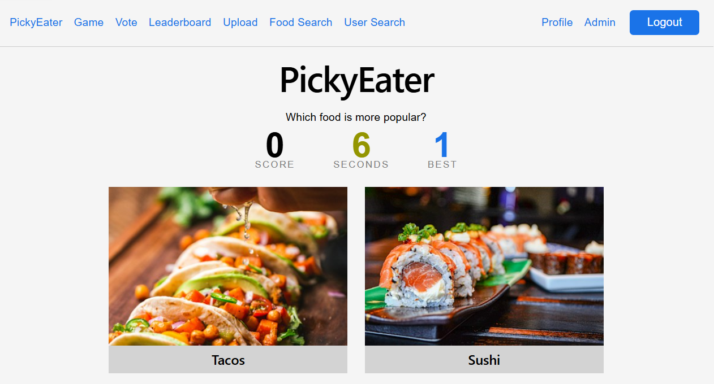
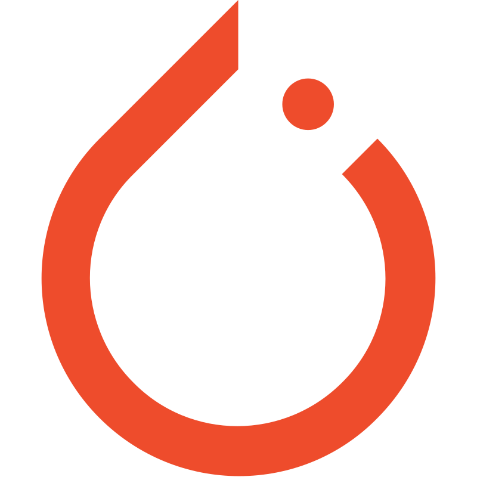
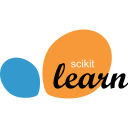
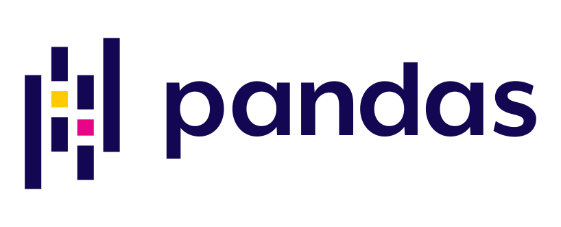
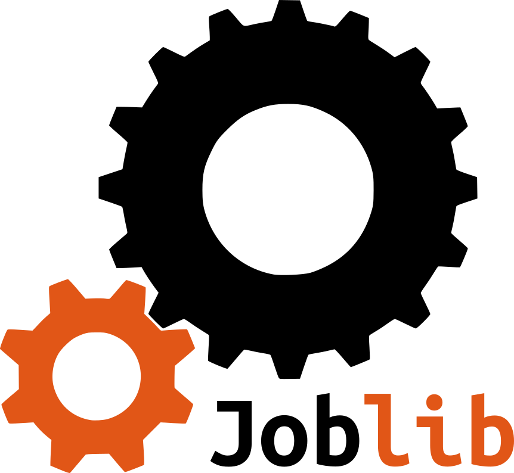
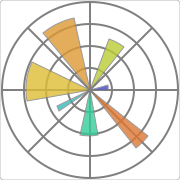
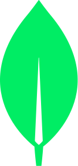
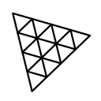

<h1 align="center"> 😎 Jacob Barbulescu 😎 </h1>

<!-- Typing SVG by DenverCoder1 - https://github.com/DenverCoder1/readme-typing-svg -->

  

<!-- Contact links -->
<!-- Badges with custom icons - https://github.com/DenverCoder1/custom-icon-badges -->

  &nbsp;&nbsp;&nbsp;
  &nbsp;&nbsp;&nbsp;
  &nbsp;&nbsp;&nbsp;
  

 

<!--INSERT SKILLS HERE-->
- 🎓 Pursuing a Bachelors of Computer Science at Stevens Institute of Technology
- 🦆 Stevens Pinnacle Scholar and Peer Leader
- 🧠 3.9 GPA
- 🤖 Experienced with developing AI systems

 

 Hi there! I'm an aspiring software engineer who is having a blast learning everything he can about Computer Science. I am especially interested in Artificial Intelligence and the public good it can bring in both the workforce and at home.

My biggest motivation in life is helping others. My work at Mathnasium helps children who are behind in school and need support. My research at Stevens has let me explore the potential good AI can bring to public health issues such as mental health support shortages and postpartum care. I have also spent the last two years as a Pinnacle Peer Advisor to help incoming freshmen transition to the college life. Not only is this kind of work satisfying to me, but it's also always a great learning experience too!

Outside of work, I enjoy making video games and producing music. It's a great creative outlet, and it's always fun to show my friends what I've been working on.

#

<!-- Projects -->

  
<h2>💻 My Projects</h2>

  <!-- List of projects -->
  <table align=center style="text-align:center;">
    <tr>
      <td>
        
      </td>
      <td>
        
      </td>
    </tr>
  </table>

#

<!-- Game repos -->

  
<h2>👾 My Games</h2>

   

  <!-- List of game repos -->
  <table align=center style="text-align:center;">
    <tr>
      <td>
        
      </td>
      <td>
        
      </td>
    </tr>
  </table>

#

<!-- Software and skills -->
<!-- Some icons made using profile-readme-generator.com -->

  
<h2>⚡ Skills</h2>

  <!-- AI Libraries -->
  <h3>🐍 Python Libraries</h3>
  

    
    &nbsp;&nbsp;
    
    &nbsp;&nbsp;
    
    &nbsp;&nbsp;
    
    &nbsp;&nbsp;
    
    &nbsp;&nbsp;
    
    &nbsp;&nbsp;
    
    &nbsp;&nbsp;
    
    &nbsp;&nbsp;
  

   

  <!-- Dev software -->
  <h3>🔨 Development Tools</h3>
  

    
    &nbsp;&nbsp;
    
    &nbsp;&nbsp;
    
    &nbsp;&nbsp;
    
    &nbsp;&nbsp;
    
    &nbsp;&nbsp;
    
    &nbsp;&nbsp;
    
    &nbsp;&nbsp;
  

   

  <!-- Programming Languages -->
  <h3>💻 Programming Languages</h3>
  

    
    &nbsp;&nbsp;
    
    &nbsp;&nbsp;
    
    &nbsp;&nbsp;
    
    &nbsp;&nbsp;
    
    &nbsp;&nbsp;
    
    &nbsp;&nbsp;
    
    &nbsp;&nbsp;
    
    &nbsp;&nbsp;
  

   

  <!-- General software -->
  <h3>🎮 Fun Software</h3>
  

    
    &nbsp;&nbsp;
    
    &nbsp;&nbsp;
    
    &nbsp;&nbsp;
    
    &nbsp;&nbsp;
    
    &nbsp;&nbsp;
    
    &nbsp;&nbsp;
  

